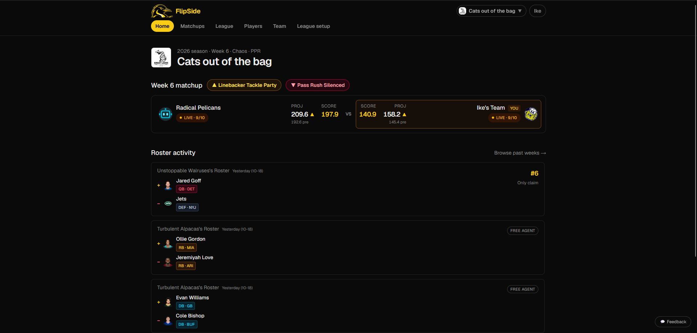
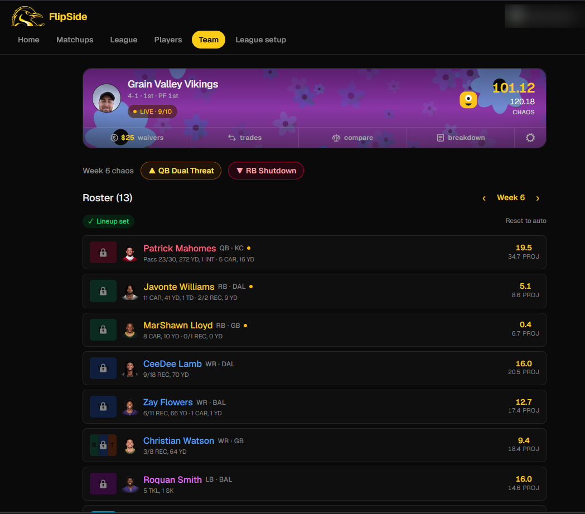
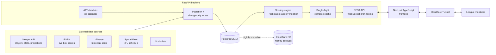

# FlipSide Fantasy: Case Study

**Live:** [app.flipsidefantasy.com](https://app.flipsidefantasy.com) · **Status:** in production since August 2026, 5 active members · **Source:** private, available on request for hiring conversations

FlipSide is a standalone fantasy sports platform I designed, built, and operate end to end. It has its own accounts, live draft rooms, rosters, waivers, trades, matchups, standings, and playoffs. Every score is computed from real NFL stats, with a weekly "chaos" layer on top (for example, a wide-receiver reception boost one week and a quarterback nerf the next). NBA leagues are supported as well.

This repository documents the architecture and the engineering decisions. The application code lives in a private repository.

_Home: the live weekly matchup, with that week's boost and nerf modifiers, projected vs. live scores, and recent roster activity across the league._

_Team: real and chaos-adjusted totals, that week's modifiers, and per-player live stat lines with projections. Game-locked slots update from the 5-minute live stats feed._

---

## At a glance

| | |
|---|---|
| **Backend** | Python, FastAPI, SQLAlchemy, WebSockets, APScheduler |
| **Frontend** | Next.js 16 (App Router), React 19, TypeScript, Tailwind CSS |
| **Database** | PostgreSQL 17 (migrated from SQLite in October 2026) |
| **Data sources** | Sleeper API, ESPN box scores, nflverse (`nfl_data_py`), SportsBlaze, odds data |
| **Infrastructure** | Cloudflare Tunnel, Cloudflare R2 (backups), Docker Compose setup |
| **Quality** | pytest suite (scoring rules, waivers, trades, lineups, auctions, auth limits) |
| **Scale of work** | 768 commits in the first two months |
| **Tooling** | Developed with Claude Code as an AI pair programmer |

---

## Architecture

---

## The data pipeline

FlipSide is, at its core, a data product: everything users see is computed from external sports data that changes constantly on game days.

**Scheduled, multi-source ingestion.** A staggered APScheduler calendar pulls each source on the cadence it actually needs:

| Cadence | Job |
|---|---|
| Every 5 min | Live box scores and game status from ESPN. No calls are made unless a game is live or kicked off in the last 12 hours, and then only those games are fetched. |
| Every 10 min | Game-day injury status and automatic lineup substitutions, active only within two hours of kickoff |
| Hourly / daily | Stats, projections, and player directory refreshes from Sleeper |
| Weekly | NFL schedule and kickoff times (SportsBlaze, with nflverse as fallback) |
| Nightly | Database backup |

The early-morning jobs are deliberately staggered so unrelated sources never pile up, and they finish before the jobs that depend on them.

**Change-only writes.** Each import diffs incoming rows against what is stored and writes only what changed. That keeps write volume low and means downstream cache versions only advance on real changes, so caches are not invalidated by no-op refreshes.

**Source reconciliation.** Stats come from more than one provider, so a reconciliation tool compares sources side by side to catch disagreements before they reach anyone's score.

**Immutable finished weeks.** About 30 hours after a week's last game goes final, every team's result is snapshotted. Later stat corrections, scoring-rule edits, or roster changes cannot rewrite a finished week, which is the data-integrity guarantee a competitive league needs.

---

## Engineering decisions

**SQLite to PostgreSQL, on a live app.** FlipSide started on SQLite. As usage and concurrency grew, I wrote a one-time migration and moved production to PostgreSQL 17 without losing league history, gaining strict foreign-key enforcement along the way. A Docker Compose stack (Postgres, backend, frontend, optional tunnel) is in place for moving to a dedicated server.

**Single-flight compute cache.** Scoring a full league is expensive. Originally, several concurrent requests for the same cold key each recomputed it in parallel, and one slow request became a site-wide stall. I changed the cache to hold a per-key lock, so a cold value is computed once no matter how many requests miss at the same moment. Writes that change scoring trigger a background re-warm.

**Real-time draft rooms.** Drafts run over WebSockets with a turn clock, autopick on timeout (taking the team's queued player first), snake, straight, and auction formats, and an unlimited-restart mock draft for practice.

**Backups people can actually restore from.** A nightly job takes a consistent database snapshot, integrity-checks it, compresses it (about 87 MB to 15 MB), and uploads it to Cloudflare R2 with daily, weekly, and monthly retention. The restore command never writes over the live database. Failures alert a private ops channel.

**Security for a public site.**
- Invite-code onboarding: no open signup, and each code is single-use
- Login and join rate limiting keyed on the real client IP behind the tunnel
- Third-party secrets (such as Discord webhooks) encrypted at rest
- Uploaded images re-encoded, with GPS and camera metadata stripped
- Request body limits and bot protection on public forms
- Interactive API docs switchable off for public deployments

**Safe development workflow.** A separate dev environment on its own ports and database means testing never touches the live site; changes are promoted to production deliberately.

---

## Features

- **Accounts:** commissioner-issued, single-use invite codes
- **Draft room:** live snake, straight, or auction drafts; mock drafts; draft queues; autopick
- **Rosters and lineups:** slot-eligibility validation (FLEX and superflex variants), automatic substitutions for players ruled out before kickoff
- **Waivers:** blind FAAB bidding with a weekly budget, processed automatically
- **Trades:** players and future draft picks, a league review window, commissioner veto, trade deadline
- **Matchups, standings, playoffs:** generated round-robin schedule and automated playoff brackets
- **Score breakdown:** click any player's points to see which stat categories and modifiers produced them
- **Configurable chaos layer:** an editable pool of boosts and nerfs, including custom per-category multipliers
- **Discord integration:** league notifications via OAuth-connected webhooks
- **NBA support** alongside NFL
- Mobile-responsive throughout

---

## What I'd highlight

- **End-to-end ownership:** I designed the data model, wrote the ingestion and scoring, built the frontend, and run production, including backups, monitoring, and incident fixes.
- **Data engineering habits applied to a product:** change-only incremental loads, multi-source reconciliation, immutable snapshots, and cache invalidation tied to real data changes.
- **Production discipline at small scale:** a live-database migration, tested restores, rate limiting, and a separate dev environment, all for a site with real users depending on it every week.

---

_Built by Isaac Beymer · [LinkedIn](https://www.linkedin.com/in/isaac-beymer) · [GitHub](https://github.com/ibeymer)_
